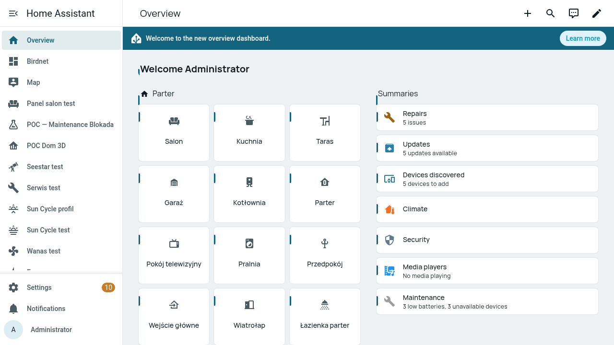
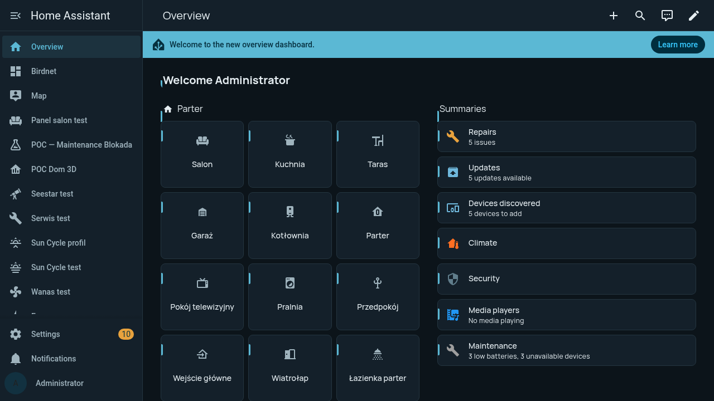
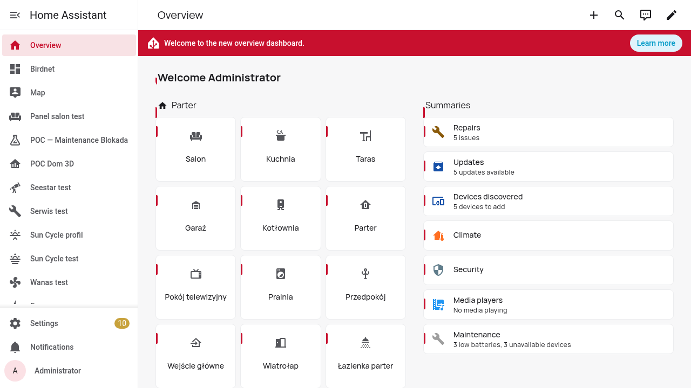
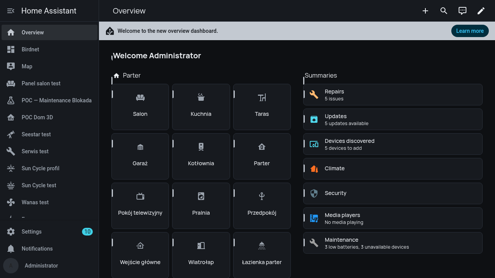

# JI Engineering Style — Home Assistant theme pack

The [JI Engineering Style](https://example.invalid/books/ji-design-system) design
system, as a set of Home Assistant frontend themes. One package, eleven themes,
each carrying **light + dark** modes that follow Home Assistant's own dark-mode
setting. Colours, tight radii and the Manrope/JetBrains type pair come straight
from the design system's single source of truth (`web/ji.css` + `themes/*.css`);
the theme YAML is generated from it, not hand-tuned.



## What you get

- **11 themes** — the base brand identity plus ten palettes (Baltic, Polish,
  Tatra, Mazury, Forest, Graphite, Copper, Nord, HighVis, Terminal).
- **Light + dark** per theme, auto-following the frontend dark-mode setting.
- **Tight JI radii** — 8px cards, 5px controls (not the generic 12–24px look).
- The **channel-tick signature** — the 3px accent bar on the leading edge of
  every card, the mark that makes an interface recognisably JI.
- **Manrope / JetBrains Mono** across the UI, with system fallbacks.

Two parts degrade silently if their dependency is absent, so the theme always
works: without the font module the type falls back to the system sans/mono;
without card-mod the channel-tick simply does not draw. Colours and radii need
neither.

## Themes

| Theme (HA name) | Primary (light / dark) | Accent | Źródło |
|---|---|---|---|
| JI Engineering | `#1557C0` / `#5FB3F0` | azure `#189CE4` | `ji-design-system/web/ji.css` |
| JI Baltic | `#12647E` / `#5BB8D4` | amber `#C77D27` | `ji-design-system/themes/baltic.css` |
| JI Polish | `#C8102E` / `#FF7A88` | gold `#C8A23C` | `ji-design-system/themes/polish.css` |
| JI Tatra | `#3E4A5B` / `#9FB2C6` | pine `#4C8C5A` | `ji-design-system/themes/tatra.css` |
| JI Mazury | `#1F6E6A` / `#5FC6BC` | reed gold `#C9A227` | `ji-design-system/themes/mazury.css` |
| JI Forest | `#245C3A` / `#6BC489` | copper `#B5712E` | `ji-design-system/themes/forest.css` |
| JI Graphite | `#2B2F36` / `#C3C9D1` | cyan `#17A2B8` | `ji-design-system/themes/graphite.css` |
| JI Copper | `#394450` / `#AEB9C6` | copper `#C2703D` | `ji-design-system/themes/copper.css` |
| JI Nord | `#5E81AC` / `#88C0D0` | frost `#88C0D0` | `ji-design-system/themes/nord.css` |
| JI HighVis | `#E8900D` / `#FFB22E` | graphite `#2B2F36` | `ji-design-system/themes/highvis.css` |
| JI Terminal | `#1E7A42` / `#3BD16F` | green `#2FB85F` | `ji-design-system/themes/terminal.css` |

Values are the resolved `--ji-*` role tokens from each source file; the YAML is
regenerated from them, so the table and the themes cannot drift apart.

## Install

### Via HACS (theme)

1. HACS → three-dot menu → **Custom repositories** → add this repo's URL with
   category **Theme**.
2. Install **JI Engineering Style**, then restart Home Assistant (or reload
   themes).
3. `frontend: themes: !include_dir_merge_named themes` must be in your
   `configuration.yaml` (it is in the HA default config).

### Manual

Copy `themes/ji-engineering.yaml` into your `/config/themes/` folder and reload
themes (Developer Tools → YAML → *Reload Themes*, or restart).

### Select the theme

Profile (bottom-left avatar) → **Theme** → pick `JI Baltic` (or any other) and
the light/dark variant. For a dashboard-wide default, call `frontend.set_theme`.

## The two optional extras

Both are off until you wire them; the theme is complete without them.

### Fonts — Manrope + JetBrains Mono

A Home Assistant theme is a list of CSS variables and cannot register a
`@font-face`, so the faces load from a small module. Copy `ji-font.js` to
`/config/www/ji/ji-font.js` and wire it in:

```yaml
frontend:
  themes: !include_dir_merge_named themes
  extra_module_url:
    - /local/ji/ji-font.js?v=1
```

It loads Manrope and JetBrains Mono from Google Fonts (the browser fetches them,
not the HA host). For a fully offline panel, self-host the `.woff2` and change
the `href` in `ji-font.js`.

### The channel-tick on cards — card-mod

The 3px accent bar on cards is injected through
[lovelace-card-mod](https://github.com/thomasloven/lovelace-card-mod) (HACS),
using this theme's own `card-mod-theme` / `card-mod-card` keys. Install card-mod
and load it as a module:

```yaml
frontend:
  extra_module_url:
    - /hacsfiles/lovelace-card-mod/card-mod.js
    - /local/ji/ji-font.js?v=1
```

Without card-mod the `card-mod-*` keys are ignored and only the colours, radii
and fonts apply.

## Gallery

| | |
|---|---|
|  |  |
| **JI Baltic — light** | **JI Baltic — dark** |
|  |  |
| **JI Polish — light** | **JI Graphite — dark** |

Screenshots: Home Assistant 2026.9.1, verified live on the JI test instance with
card-mod and the font module wired.

## Source of truth / regenerating

The YAML is generated from the design system repo
(`the JI design system`). To regenerate after a palette change there:

```
python3 tools/gen_ha_theme.py <path-to-ji-design-system> themes/ji-engineering.yaml
```

Do not hand-edit `themes/ji-engineering.yaml`; change the tokens in the design
system and regenerate, so web, Android and Home Assistant stay one system.

## Licence

MIT — see `LICENSE`.
